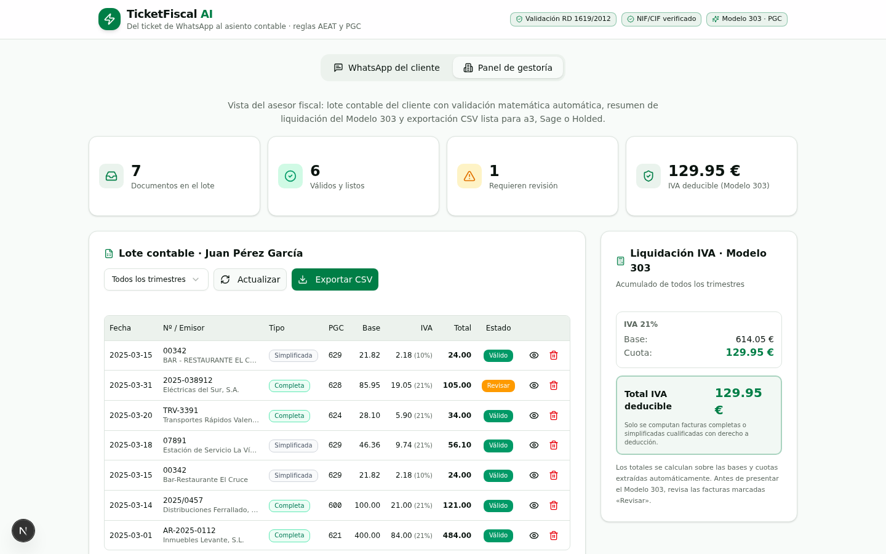

# TicketFiscal AI

> Del WhatsApp del cliente al asiento contable. La IA auditora que lee tickets y facturas de autónomos y pymes españolas, valida el IVA con reglas AEAT/PGC y deja el lote listo para importar en a3, Sage o Holded.

Demo para gestorías: el cliente reenvía la foto de un justificante por WhatsApp y, en segundos, el sistema extrae los datos fiscales, verifica la matemática del IVA/IRPF, valida el dígito de control del NIF/CIF de forma determinística, clasifica el gasto en el Plan General Contable y avisa al cliente si hay que pedir la factura completa.

## Qué demuestra



| Muestra incluida | Qué pone a prueba |
| --- | --- |
| `factura-completa.png` — Distribuciones Ferrallado, S.L. | Factura completa A4: NIFs de emisor y receptor, IVA 21 %, cuenta 600 del PGC. IVA deducible. |
| `ticket-restaurante.png` — Bar El Cruce | Factura simplificada con IVA 10 % incluido: cálculo retroactivo de la base y detección de **IVA no deducible** (art. 97 LIVA) con aviso para pedir la factura completa. |
| `factura-error.png` — Eléctricas del Sur, S.A. | Factura con **dos trampas**: cuota de IVA que no cuadra con la base (descuadre de 1,00 €) y **CIF con dígito de control erróneo**. El sistema marca `REQUIERE_REVISION` y explica ambos motivos. |
| `ticket-gasolinera.png` — Estación de Servicio La Vía | Ticket de gasóleo con IVA 21 % incluido: desglose retroactivo (base 46,36 € + cuota 9,74 €), cuenta 629. |

El panel de gestoría incluye resumen de liquidación del **Modelo 303** por tipo de IVA (21/10/4/0 %), filtro por trimestre, detalle de cada documento y **exportación CSV** con formato contable español (separador `;`, decimales con coma, BOM UTF-8) lista para ERP.

## Arquitectura

- **Next.js 16 (App Router) + TypeScript + Tailwind + shadcn/ui**
- **Prisma + SQLite** en local, con capa de datos aislada (`src/lib/store.ts`)
- **Motor de visión GLM** vía `z-ai-web-dev-sdk` con un system prompt calibrado como auditor AEAT/PGC (`src/lib/fiscal.ts`)
- **Doble validación server-side**, independiente de la IA:
  - `src/lib/fiscal.ts` → matemática AEAT: base + cuota IVA − retención IRPF = total (±0,02 €) y coherencia cuota = base × tipo
  - `src/lib/nif.ts` → **validador determinístico de NIF/NIE/CIF** (dígito de control en TypeScript). Próximo hito: consulta al censo VIES/AEAT.

```
src/
  app/
    page.tsx                    # Demo: pestañas WhatsApp + Panel de gestoría + hoja de ruta
    api/documents/route.ts      # POST extracción IA + validaciones · GET listado · DELETE
    api/documents/export/route.ts # Exportación CSV (a3/Sage/Holded)
  lib/
    fiscal.ts                   # System prompt auditor AEAT/PGC + validación matemática
    nif.ts                      # Validación determinística NIF/NIE/CIF (dígito de control)
    store.ts                    # Capa de datos: SQLite/Prisma o memoria (serverless)
    zai-server.ts               # Acceso al motor de visión (SDK o fetch directo por env vars)
    seed.ts                     # Lote contable de demostración
  components/fiscal/            # Chat WhatsApp + panel del asesor
prisma/schema.prisma            # Modelo Documento
scripts/gen_receipts.py         # Regenera las muestras PNG (Playwright)
```

## Puesta en marcha

```bash
bun install          # ejecuta prisma generate (postinstall)
cp .env.example .env # DATABASE_URL apunta a SQLite local
bun run db:push      # crea la base de datos
bun run dev          # http://localhost:3000
```

La primera vez, el lote contable se siembra automáticamente con datos de demostración.

### Variables de entorno

| Variable | Obligatoria | Descripción |
| --- | --- | --- |
| `DATABASE_URL` | No | SQLite en local. **Sin ella, la app arranca en modo memoria** (ideal para Vercel). |
| `ZAI_BASE_URL`, `ZAI_API_KEY` | No | Motor de visión en serverless. En local el SDK lee su `.z-ai-config`. Opcionales: `ZAI_TOKEN`, `ZAI_CHAT_ID`, `ZAI_USER_ID`, `ZAI_MODEL`. |

## Despliegue en Vercel

El despliegue funciona sin configurar nada:

- **Sin `DATABASE_URL`**: la capa de datos arranca en *modo memoria* con el lote de demostración (se reinicia en cada arranque en frío). Conectar Supabase/Neon (PostgreSQL) solo requiere cambiar el provider de Prisma y la `DATABASE_URL` — la lógica fiscal y la UI no se tocan.
- **Sin credenciales del motor IA**: la extracción de las muestras conocidas responde en *modo demostración* (respuesta preconfigurada, etiquetada como simulada en la interfaz). Sube las variables `ZAI_*` en el proyecto de Vercel para activar la extracción real.

## Hoja de ruta

- [x] **Validación NIF/CIF determinística** — dígito de control verificado en TypeScript antes de aprobar el documento.
- [ ] **Multi-empresa con PostgreSQL** (Supabase/Neon): 1 gestoría → N empresas → N números de WhatsApp autorizados, con autenticación para el asesor.
- [ ] **Conciliación bancaria** — GoCardless Bank Account Data: cruce del extracto real del banco español con los justificantes recibidos.
- [ ] **RGPD** — hosting en la UE (Frankfurt/París) y contrato de Encargado del Tratamiento para datos reales.
- [ ] **Censo VIES/AEAT** — verificación de NIFs contra registros oficiales.

## Aviso

Demo con **datos ficticios**. No constituye asesoramiento fiscal: las validaciones implementan reglas generales (RD 1619/2012, LIVA, PGC) y siempre requieren revisión profesional antes de presentar liquidaciones.
